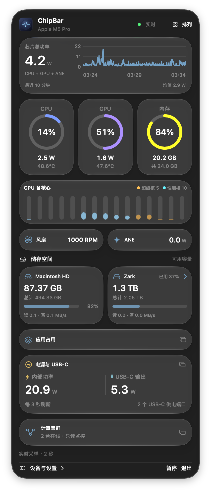
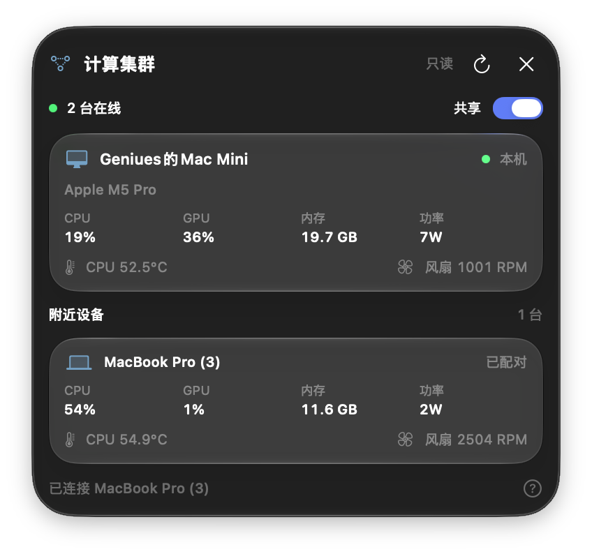
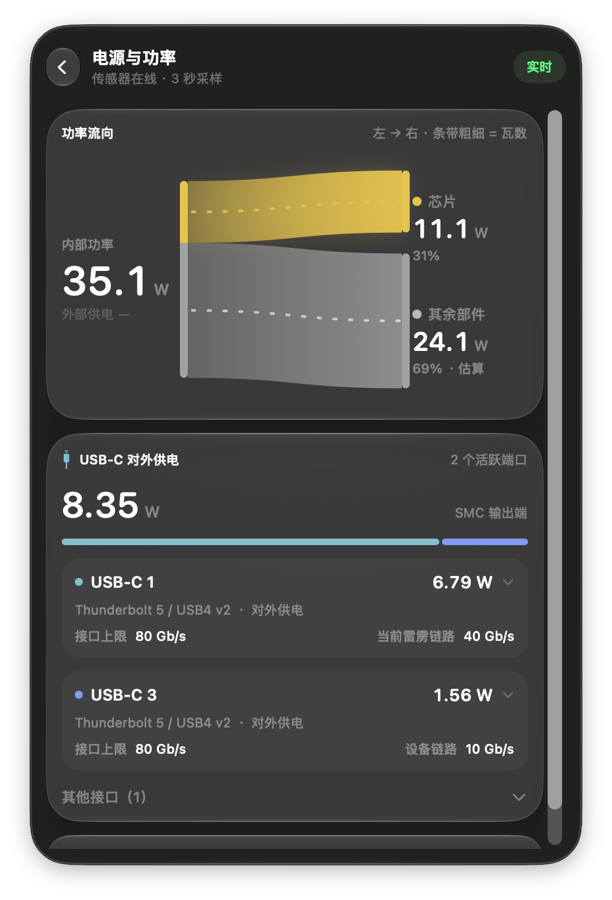
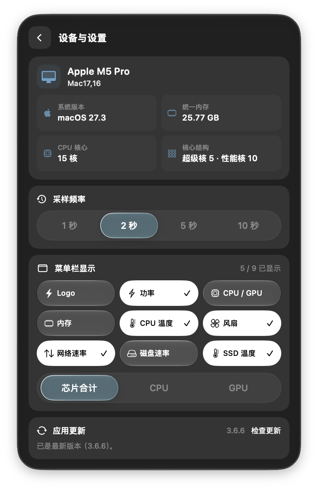
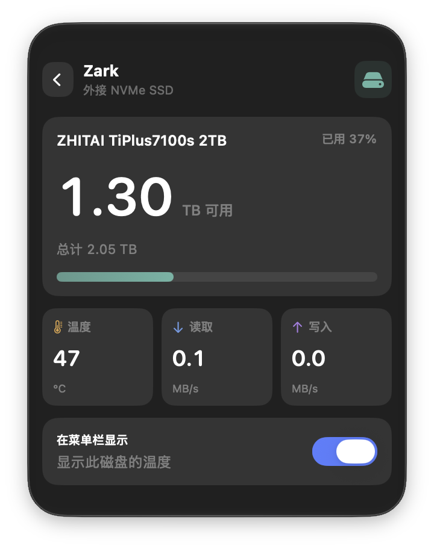

# ChipBar

**Native Apple Silicon monitoring, with an optional read-only two-Mac cluster.**

<p align="left">
  <a href="README.zh-CN.md">简体中文</a> ·
  <a href="https://github.com/wwwwzzzzkkkk/ChipBar/releases/latest">Latest release</a> ·
  <a href="CHANGELOG.md">Changelog</a> ·
  <a href="docs/RELEASE_HISTORY.md">Historical releases</a> ·
  <a href="docs/CLUSTER_MONITOR.md">Cluster guide</a>
</p>

<p align="center"><a href="docs/images/user-dashboard.png"></a></p>
<p align="center"><sub>Actual Mac screenshot · 848 × 1972 native pixels · click to view the original</sub></p>

## What ChipBar monitors

ChipBar is a compact native menu-bar companion for Apple Silicon Macs. It uses SwiftUI, AppKit and system-native glass materials (with fallbacks on older macOS versions).

| Monitoring | What you see |
| --- | --- |
| **Chip & CPU / GPU** | CPU, GPU and ANE power when available; chip power history, load rings, per-core activity |
| **Memory & cooling** | Used memory, macOS memory-pressure status, CPU temperature and actual fan RPM |
| **Power & USB-C** | Internal power flow, power source and available USB-C output measurements |
| **Storage & network** | Internal/external disk space, read/write throughput and network transfer rates |
| **External NVMe SSD** | Optional SMART temperature and status where the device and enclosure support it |
| **App activity** | Process CPU/GPU/ANE-accounting information when available; missing data stays unknown |
| **Widgets** | Native macOS WidgetKit dashboard and storage widgets, refreshed within system budgets |

Sample intervals are configurable at **1, 2, 5 or 10 seconds** for macmon-backed metrics. The live power chart keeps approximately ten minutes in memory; this release **does not** provide persistent seven-day history or threshold notifications. Measurements may be unavailable on some chip/macOS combinations; unsupported values are not fabricated.

## Real Mac screenshots

These five images are **actual screenshots provided by the developer**, not AI-generated illustrations or CI fixtures. GitHub controls display width only. Click each image to open its original full-resolution PNG.

### Compute Cluster & Power

<table>
<tr><td width="50%" align="center" valign="top"><a href="docs/images/user-cluster.png"></a></td><td width="50%" align="center" valign="top"><a href="docs/images/user-power.png"></a></td></tr>
<tr><td align="center"><b>Compute Cluster</b><br>Read-only dual-Mac telemetry, CPU/GPU, power and fans.</td><td align="center"><b>Power &amp; USB-C</b><br>Internal power flow and per-port activity.</td></tr>
</table>

### System & Storage

<table>
<tr><td width="50%" align="center" valign="top"><a href="docs/images/user-settings.png"></a></td><td width="50%" align="center" valign="top"><a href="docs/images/user-ssd.png"></a></td></tr>
<tr><td align="center"><b>Device &amp; Settings</b><br>Hardware details, refresh rate and menu bar options.</td><td align="center"><b>External SSD</b><br>Capacity, temperature and live disk speeds.</td></tr>
</table>

<p align="center"><sub>Native dimensions: dashboard 848×1972 · cluster 848×794 · power 932×1372 · settings 848×1304 · SSD 720×912</sub></p>

## Compute Cluster · read-only by design

The optional Cluster panel monitors this Mac and other **explicitly paired Macs** on a trusted local network, including over a configured Thunderbolt Bridge. It displays CPU/GPU use, memory, chip watts, CPU temperature, fan RPM and current simulation status when reliable information exists.

Cluster states are displayed separately:

| Status | Meaning |
| --- | --- |
| **Pair another Mac** | No trusted peer is configured |
| **Sharing disabled** | Sharing was explicitly paused |
| **Searching for Macs** | Discovery is active but no peer has been found |
| **Waiting for telemetry** | A peer was discovered; approval or a valid sample is pending |
| **Connected** | Fresh authenticated data is available |
| **Peer offline** | A previously observed peer has stopped providing fresh readings |

Pairing uses an on-screen six-digit comparison and per-device keychain trust; transmitted telemetry is authenticated and encrypted. OpenFAST progress is obtained from observed running tasks, fresh supported logs/results, or a status file written by your own tooling. Unknown progress is displayed as unknown; CPU usage is never treated as completion percentage.

**ChipBar is a monitor, not an orchestrator.** It cannot start, stop, cancel, schedule or execute OpenFAST simulations; it provides no remote shell. All computation remains controlled by you or your external tools. See the [complete pairing and progress guide](docs/CLUSTER_MONITOR.md).

## Install

**Requirements:** Apple Silicon Mac (arm64), **macOS 13 Ventura or newer**. **ChipBar 4.0.0 still requires [macmon](https://github.com/vladkens/macmon) to be installed separately**; an app-bundled macmon and Apple notarization are planned separately and are **not included** here. Some M5-family sensor readings have not been validated across all hardware/OS versions.

### Homebrew (recommended)

The standalone ChipBar repository itself serves as the Homebrew tap; it is not a separate `homebrew-chipbar` repository.

```sh
brew tap --custom-remote wwwwzzzzkkkk/chipbar https://github.com/wwwwzzzzkkkk/ChipBar.git
brew install --cask wwwwzzzzkkkk/chipbar/chipbar
```

The Cask declares `macmon` as a Homebrew dependency. To upgrade:

```sh
brew upgrade --cask wwwwzzzzkkkk/chipbar/chipbar
```

### Manual installation

1. Install `macmon`: `brew install macmon`.
2. Download the latest **`ChipBar-macOS-arm64.zip`** and **`SHA256SUMS`** from [GitHub Releases](https://github.com/wwwwzzzzkkkk/ChipBar/releases/latest).
3. Verify the downloaded ZIP against `SHA256SUMS`, unzip, and move `ChipBar.app` to your Applications folder.
4. Launch ChipBar from Applications. For supported external NVMe SMART data, install `smartmontools` separately.

**Signing disclosure:** This release uses an **ad-hoc macOS signature**, not Apple Developer ID signing, and **has not been notarized**. Gatekeeper may require manual approval in **System Settings → Privacy & Security** after you have verified the official download. ChipBar does not install a privileged daemon for basic sensor monitoring.

## Languages

The main application supports **English and Simplified Chinese**, selected from macOS preferred languages. Native WidgetKit strings have their own existing English and Simplified Chinese translations. Language coverage includes dashboard labels, major settings, Cluster pairing/status UI, and common runtime messages. Platform/driver error messages and proper device names may be displayed as supplied by macOS.

## Build from source

```sh
git clone https://github.com/wwwwzzzzkkkk/ChipBar.git
cd ChipBar
./scripts/test.sh
./scripts/build.sh
open dist/ChipBar.app
```

Building requires a macOS Xcode/Swift toolchain and a compatible Apple Silicon target. CI builds the arm64 app and its real WidgetKit extension, then verifies signatures and the release archive. The repository's `VERSION`, `CHANGELOG.md` and `scripts/version.py` govern releases.

## Privacy, licensing and limitations

- ChipBar stores settings and monitoring snapshots on-device; Cluster peer identities are stored in macOS Keychain.
- Network sharing is opt-in and restricted to mutually approved LAN peers. No public Internet remote-control service is provided.
- Remote simulation reporting is read-only. ChipBar does not collect complete output data or transfer simulation files.
- Sensor availability depends on hardware, macOS version and installed macmon/smartmontools.
- This is **not** an Apple-endorsed performance diagnostic and does not claim exact hardware power/throttling identification.

The underlying sensor collector is [vladkens/macmon](https://github.com/vladkens/macmon), distributed under the [MIT License](LICENSE). Other third-party references are credited in [power sensor licenses](THIRD_PARTY_POWERSENSORS_LICENSE.md) and [USB-C licenses](THIRD_PARTY_USBC_LICENSE.md).

**Feedback:** [Issues](https://github.com/wwwwzzzzkkkk/ChipBar/issues) · **Release:** [ChipBar v4.0.0](https://github.com/wwwwzzzzkkkk/ChipBar/releases/tag/chipbar-v4.0.0).
