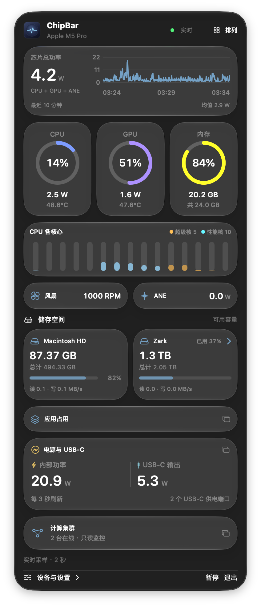
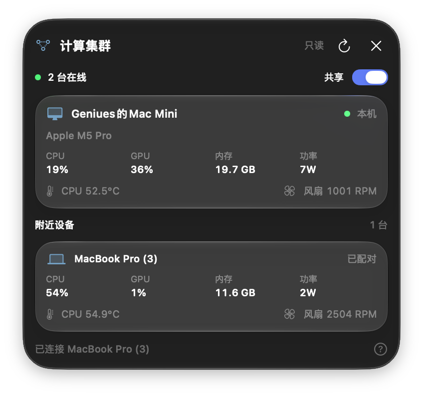
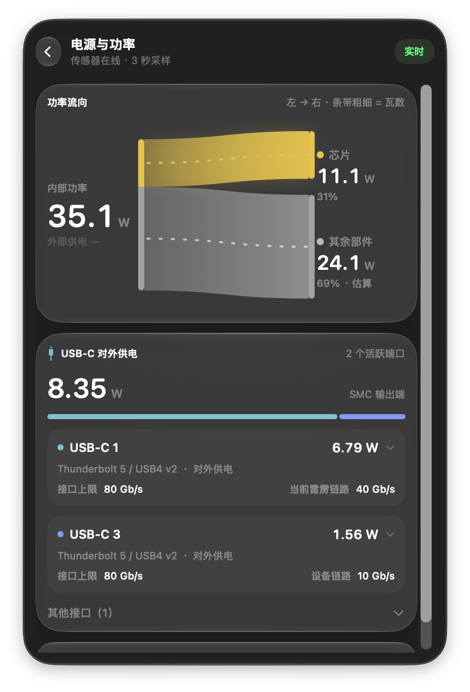
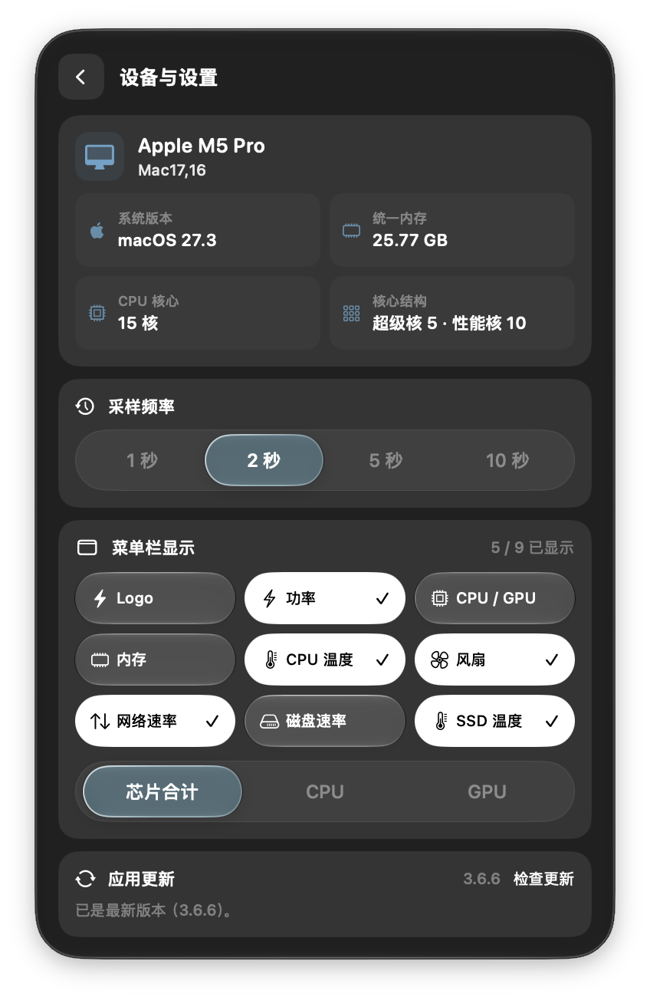
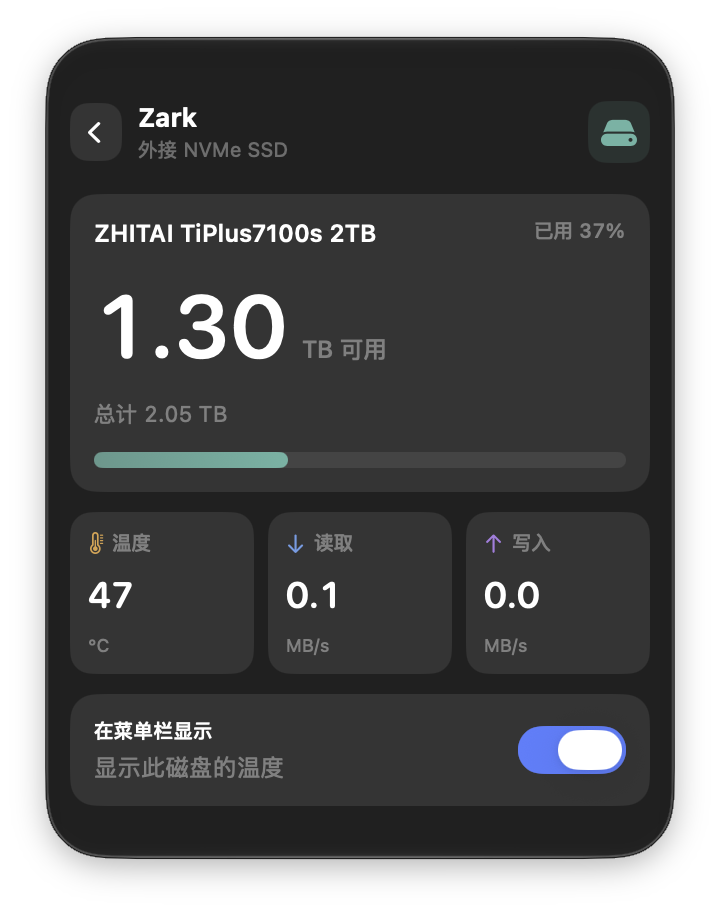

# ChipBar

**为 Apple Silicon 设计的原生菜单栏性能监控工具，支持可选的双 Mac 只读计算集群。**

[English](README.md) · [最新版本](https://github.com/wwwwzzzzkkkk/ChipBar/releases/latest) · [更新记录](CHANGELOG.md) · [计算集群指南](docs/CLUSTER_MONITOR.md)

<p align="center"><a href="docs/images/user-dashboard.png"></a></p>
<p align="center"><sub>真实运行界面 · 原始 848 × 1972 像素 · 点击查看原图</sub></p>

## 核心功能

ChipBar 提供芯片总功率与趋势、CPU/GPU 占用及功率、ANE 功率（有数据时）、逐核心负载、内存与系统内存压力、风扇转速、CPU 温度、内置及外置硬盘容量与读写速率、网络速度、应用资源占用以及 USB-C / 内部供电监控。兼容 macOS WidgetKit 仪表盘与储存空间小组件，较新系统呈现原生 Liquid Glass 风格。

传感器刷新间隔可选 **1 / 2 / 5 / 10 秒**。功率曲线目前保留约 10 分钟；**v4.0.0 不含长期 SQLite 历史和阈值通知**。若传感器无法提供数据，会显示不可用，不会伪造功率或仿真进度。

## 真实高清运行截图

以下五张均是开发者上传的 **ChipBar 实机截图原图**，不是 AI 效果图，也不是 CI 模拟截图。README 只限制页面显示宽度，不改变原始图片的像素；点击可打开完整清晰度。

### 计算集群与电源监控

<table>
<tr><td width="50%" align="center" valign="top"><a href="docs/images/user-cluster.png"></a></td><td width="50%" align="center" valign="top"><a href="docs/images/user-power.png"></a></td></tr>
<tr><td align="center"><b>计算集群</b><br>两台 Mac 的只读性能监控。</td><td align="center"><b>电源与功率</b><br>桑基图功率流向与接口供电。</td></tr>
</table>

### 设备设置与 SSD

<table>
<tr><td width="50%" align="center" valign="top"><a href="docs/images/user-settings.png"></a></td><td width="50%" align="center" valign="top"><a href="docs/images/user-ssd.png"></a></td></tr>
<tr><td align="center"><b>设备与设置</b><br>硬件信息、采样间隔和菜单栏选项。</td><td align="center"><b>外接 SSD</b><br>可用容量、温度与读写速度。</td></tr>
</table>

<p align="center"><sub>原始尺寸：主界面 848×1972 · 集群 848×794 · 电源 932×1372 · 设置 848×1304 · SSD 720×912</sub></p>

## 计算集群（只读）

通过局域网或已建立 IP 网络的 Thunderbolt Bridge，连接已确认配对的两台 Mac。两端核对六位数字并分别同意，设备信任信息保存在钥匙串，遥测通过加密和认证传输。

v4.0.0 明确区分以下状态：

- **等待设备配对**：尚未配对其他 Mac。
- **未开启共享**：当前明确暂停了共享。
- **正在搜索附近的 Mac**：没有发现其他设备。
- **等待远端数据**：已发现设备，等待授权或有效采样。
- **已连接**：正在接收新鲜、有效的远端遥测数据。
- **设备离线**：此前的远端设备停止提供新鲜数据。

可查看本机和远端 CPU/GPU、内存、功率、CPU 温度、风扇 RPM，以及 OpenFAST 当前仿真任务与可信的进度来源。没有足够证据时显示“进度未知”。

**ChipBar 仅负责监控，不启动、停止、取消、执行或调度任何仿真任务，也不提供远程 Shell。** 用户或外部 GPT/Codex 脚本继续完全控制计算。详见 [集群连接与进度指南](docs/CLUSTER_MONITOR.md)。

## 下载安装

**系统要求**：Apple Silicon (arm64)、macOS 13 或更新版本。

**重要说明：ChipBar 4.0.0 仍然需要单独安装 [macmon](https://github.com/vladkens/macmon)。本次不包含内置 macmon、Developer ID 签名与 Apple 公证。** 某些 M5 系列传感器尚待不同硬件环境验证。

推荐 Homebrew：

```sh
brew tap --custom-remote wwwwzzzzkkkk/chipbar https://github.com/wwwwzzzzkkkk/ChipBar.git
brew install --cask wwwwzzzzkkkk/chipbar/chipbar
```

更新：

```sh
brew upgrade --cask wwwwzzzzkkkk/chipbar/chipbar
```

独立仓库同时维护 Homebrew Cask。配方声明 `macmon` 为安装依赖。

手动安装：先运行 `brew install macmon`，再从 [GitHub Release](https://github.com/wwwwzzzzkkkk/ChipBar/releases/latest) 下载 `ChipBar-macOS-arm64.zip` 和 `SHA256SUMS`，核对校验值后解压，将 `ChipBar.app` 移入“应用程序”。如需要外接 SSD SMART 温度，可另行安装 `smartmontools`，同时取决于硬盘盒支持情况。

当前安装包为 **ad-hoc 本地签名，尚未经过 Apple Developer ID 公证**，Gatekeeper 可能拦截；请先确认下载来源和校验值，再根据“系统设置 → 隐私与安全性”中的提示允许。

## 英文界面和隐私

v4.0.0 提供英文与简体中文界面，跟随 macOS 首选语言。主页、主要设置、集群连接与配对、侧边面板和常见错误提示已进行本地化；某些系统/驱动的原始错误信息仍可能使用系统返回语言。

设置与监控快照主要保存在本机；只与已相互确认的 LAN 设备交换只读遥测。没有公开互联网远程控制入口，也不自动同步完整仿真输出文件。

## 源码、许可与反馈

```sh
git clone https://github.com/wwwwzzzzkkkk/ChipBar.git
cd ChipBar
./scripts/test.sh
./scripts/build.sh
open dist/ChipBar.app
```

基础指标采集依赖 [vladkens/macmon](https://github.com/vladkens/macmon)，保留原 [MIT 许可](LICENSE) 及 [功率传感器](THIRD_PARTY_POWERSENSORS_LICENSE.md)、[USB-C](THIRD_PARTY_USBC_LICENSE.md) 相关第三方声明。

[反馈问题](https://github.com/wwwwzzzzkkkk/ChipBar/issues) · [ChipBar v4.0.0 发布页](https://github.com/wwwwzzzzkkkk/ChipBar/releases/tag/chipbar-v4.0.0)
